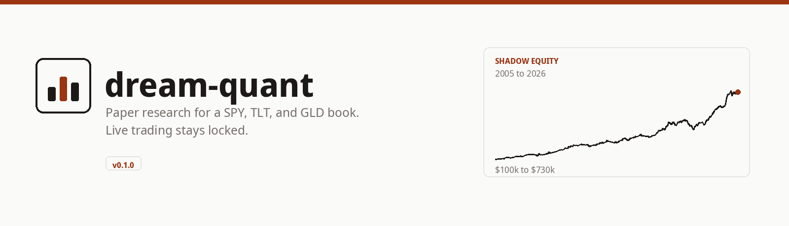
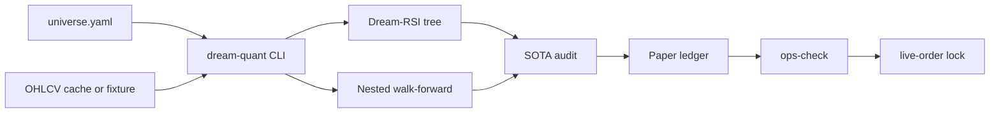
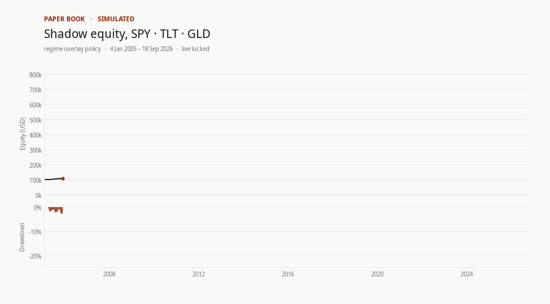

<p align="center">
  
</p>

# dream-quant

dream-quant audits a SPY, TLT, and GLD risk-parity book with purged cross-validation, then tracks that research in a shadow paper account. Live orders stay off until a person opens three separate locks.

[](pyproject.toml)
[](https://www.python.org/)
[](pyproject.toml)
[-1c1917?style=flat-square)](#getting-started)
[](LICENSE)
[](#usage)

There is no hosted CI workflow in this repository. `pytest` is the test gate, run locally.

## Contents

- [Key features](#key-features)
- [Architecture](#architecture)
- [Getting started](#getting-started)
- [Usage](#usage)
- [Current results](#current-results)
- [Contributing](#contributing)
- [License](#license)

## Key features

- **Pre-registered risk-parity book** on SPY, TLT, and GLD (`rp2_corr35_rebal42`: 63-day vol, 42-bar rebalance, 0.35 bond scale when equity–bond correlation is positive).
- **Dream-RSI discovery** writes a tree of attempts and a replay-only policy update before a champion is chosen.
- **Nested walk-forward** tunes on inner folds and reports outer-test Sharpe only. A 252-day holdout never enters selection.
- **SOTA audit**: combinatorial purged cross-validation, probability of backtest overfitting, deflated and probabilistic Sharpe, a permutation null, cost stress, and baselines (SPY buy-and-hold, static 60/40, equal weight).
- **Shadow paper account** with a kill switch, a forward-integrity check, and a frozen overlay policy for the daily book.
- **Triple lock on live orders.** Readiness, `DREAM_QUANT_LIVE=1`, and `--i-understand-risk` are all required. The daily job sets none of them.

## Architecture



| Layer | What it uses |
| --- | --- |
| Language | Python 3.10+ |
| CLI | Click (`dream-quant`) |
| Data | pandas, NumPy, YAML config. Optional `yfinance` via `dream-quant[fetch]` |
| Research | In-house walk-forward, Dream-RSI replay, CPCV / PBO / DSR |
| Optional extras | `purgedcv`, `vectorbt`, `quantstats` (`dream-quant[oss]`) |
| Tests | pytest, offline fixtures |
| Runtime state | `artifacts/` for audits, the paper ledger, and ops snapshots |

The package layout follows that pipeline: `dream_quant/data`, `discovery`, `research`, `validation`, `portfolio`, `paper`, and `broker`. The broker path is a stub. It refuses a live order unless the three locks are open.

## Getting started

**Prerequisites:** Python 3.10 or newer, and `pip`. A checkout of this repository.

From the repo root:

```bash
python3 -m venv .venv
source .venv/bin/activate          # Windows: .venv\Scripts\activate
python -m pip install -e ".[dev]"
dream-quant paper-status --config configs/universe.yaml
```

That is the path to a running status report. The command reads the committed paper artifacts and the local price cache. With no cache, add `--fixture`.

Run the suite when you want the test gate:

```bash
pytest -q
```

Fresh bars are optional:

```bash
python -m pip install "dream-quant[fetch]"
dream-quant fetch-data --config configs/universe.yaml
```

## Usage

Daily status of the paper book:

```bash
dream-quant paper-status --config configs/universe.yaml
```

```text
RESEARCH/PAPER MODE ONLY — no live brokerage orders. Not financial advice. Past backtests do not guarantee future results. | source=cache | champion=rp2_corr35_rebal42
Research: READY | deploy_eligible=True
Paper: equity=$730,294 sharpe=1.021 aligned=True regime_stress=False
Rolling Sharpe 30/90/252: 0.346 / 0.105 / 1.144
Kill trips: 0 halted=False
Last bar: 2026-09-18 04:00:00+00:00
```

Audit the research book. This rewrites `artifacts/sota_audit/`:

```bash
dream-quant sota-audit --config configs/universe.yaml
```

The committed verdict is `artifacts/sota_audit/VERDICT.json` (12/12 gates, 18 September 2026).

A live order without the locks:

```bash
dream-quant live-order --symbol SPY --side buy --qty 1
```

```text
Error: Live order blocked. Set DREAM_QUANT_LIVE=1, pass readiness gates, and use --i-understand-risk.
```

Other workflows, all on `configs/universe.yaml`:

| Command | What it does |
| --- | --- |
| `./scripts/cron_forward_paper.sh` | After the US close: append bars, refresh the ledger, run `ops-check` |
| `ops-check` | Exit 0 healthy, 1 ineligible or halted, 2 missing inputs |
| `harden-iterate --no-fetch` | Research, diversify, stability, regime search, forward paper |
| `research-try --no-fetch` | Dream-RSI, then search, then a `try_NNN/` manifest |
| `autonomous-paper --mode backfill` | One-time historical warm-up, not the daily job |

`ops-check` exits **0** when the book is deploy-eligible and not halted, **1** on a kill switch, halt, or integrity failure, and **2** when artifacts or data are missing.

## Current results

Audited 18 September 2026. Paper snapshot 19 September 2026, 12:38 Paris (10:38 UTC). Last bar 18 September 2026. Full precision is in [`artifacts/sota_audit/VERDICT.json`](artifacts/sota_audit/VERDICT.json).

The research champion and the paper overlay are different frozen parameter sets. Read each row in its own table.

### Research champion `rp2_corr35_rebal42`

| Check | Result | Bar |
| --- | ---: | ---: |
| Gates passed | 12 / 12 | all required |
| CPCV median Sharpe @ 5 bps | 0.94 | ≥ 0.80 |
| vs SPY buy-and-hold / static 60/40 | 0.94 vs 0.58 / 0.77 | must beat both |
| Probability of backtest overfitting | 0.00 | ≤ 0.40 |
| Deflated Sharpe (N = 12) / PSR | 1.00 / 1.00 | ≥ 0.95 |
| Permutation p | 0.028 | ≤ 0.05 |
| Locked 252-day holdout Sharpe | 1.79 | ≥ 0.30 |
| Locked holdout max drawdown | −5.1% | better than −15% |

### Paper overlay

[`artifacts/paper/forward_equity.csv`](artifacts/paper/forward_equity.csv) starts at $100,000 on 4 January 2005 and ends at **$730,294** on 18 September 2026 (21.7 years, **9.6%** CAGR). Full-sample Sharpe **1.02**, max drawdown **−21.3%**. Trailing 30 / 90 / 252-day Sharpe: **0.35 / 0.10 / 1.14**.



## Contributing

1. Branch from `main`.
2. Install the dev extra and run `pytest -q` before opening a pull request.
3. Leave `data/cache/*.csv` untracked. The gitignore already excludes those files.
4. If a change updates an audit or the paper ledger, commit the artifact that the command wrote and name the command in the pull request.
5. Leave the live path locked. Do not set a default for `DREAM_QUANT_LIVE`, and do not call a broker from the cron script.

Research claims belong next to the artifact that produced them (`VERDICT.json`, `ops_snapshot.json`, or a `try_NNN/` manifest).

## License

[MIT](LICENSE). Copyright (c) 2026 Sebastian Roda.

This software is a research record and a simulator. Past out-of-sample paths and the paper ledger are not a forecast and not advice.
